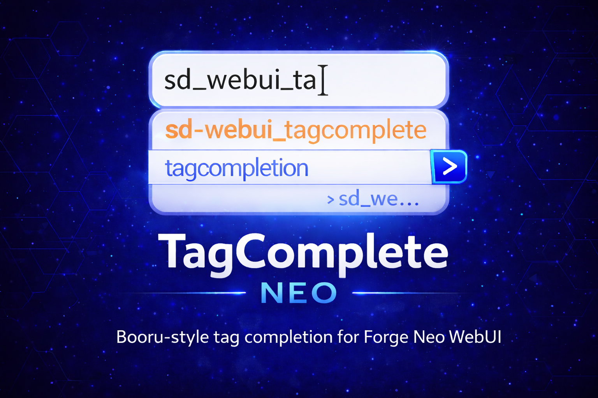

> **Extension for [Stable Diffusion WebUI Forge - Neo](https://github.com/Haoming02/sd-webui-forge-classic/tree/neo)**

# 🏷️ TagComplete Neo

Tag autocompletion for Forge Neo — suggests Danbooru/e621 tags, LoRA/embedding names, wildcards, and chants as you type, with automatic trigger word injection and CivitAI lookup support.

Fork of [a1111-sd-webui-tagcomplete](https://github.com/DominikDoom/a1111-sd-webui-tagcomplete) by [DominikDoom](https://github.com/DominikDoom), maintained here exclusively for Forge Neo. If you are not running Forge Neo, use the [original extension](https://github.com/DominikDoom/a1111-sd-webui-tagcomplete) instead.

---

## 📋 Table of Contents

- [What's New](#-whats-new)
- [Changelog](#-changelog)
- [Roadmap](#️-roadmap)
- [Features](#-features)
- [Installation](#-installation)
- [Tag Lists](#-tag-lists)
- [Credits](#-credits)

---

## 🆕 What's New

### v0.5.1: Tags that start with a symbol

- **ANIMA artists without typing `@`**: with a tag file whose artists are written `@name`, typing the first letters of the name suggests them again, and your frequent ones (✨) come back to the top. The same goes for any tag word after a symbol, like `(artist)` or `:3` ([#8](https://github.com/eduardoabreu81/sd-webui-tagcomplete-neo/issues/8))

### v0.5.0: Tags with spaces

- **Type tags with spaces**: `long hai` now suggests `long_hair`, and picking it replaces both words. Prompts written in plain sentences keep suggesting single tags as before ⭐
- **Faster sorting** of suggestions when "Recent, then frequent" frequency sorting is on ⭐

---

---

## 📖 Changelog

### v0.5.1: Tags that start with a symbol
- The indexed search (`Use indexed search`, on by default) now finds every tag the full scan finds. It only indexed the start of each `_`/space-separated word, so a 3+ letter search missed tags where the word follows another symbol, such as ANIMA's `@artist` names or `style_(artist)`, and the usage sort never saw them. The index now has a key wherever the search can match, including aliases and their translations (#8)
- A search starting with `*` (match anywhere) no longer uses the index, which can't cover it

### v0.5.0: Tags with spaces
- When the last two or three words before the cursor are plain words separated by single spaces and match a tag together (`long hai` → `long_hair`), they are searched and replaced as one tag. Otherwise only the last word is searched, as before. Words inside brackets, weights, extra networks or wildcards are not combined
- Usage sorting looks up the "Recent, then frequent" ranks once per search instead of on every comparison
- Ideas from [asugonomi](https://github.com/asugonomi)'s fork

### v0.4.0: Prompt helpers
- New `Dim results the prompt already contains` and `Choosing a tag the prompt already contains selects it instead of adding a duplicate` settings (both on by default). The selection only happens when the typed word sits alone between commas; inside brackets or weights the tag is inserted as before
- New `Prompt formatter` setting (Off / Manual (Alt+Shift+F) / Automatic (on blur), default Manual) and `Prompt formatter ends each line with a comma`. Tags are joined with `, ` or `,` following `Append space on tag autocompletion`; bracket contents, quoted text and line breaks stay as written, and prompts with unbalanced brackets or quotes, or plain number lists, are left untouched
- Ideas adapted from [ComfyUI-Autocomplete-Plus](https://github.com/newtextdoc1111/ComfyUI-Autocomplete-Plus) (MIT)

### v0.3.2: Settings apply right away
- Setting changes now reach the extension through Forge Neo's `onOptionsChanged` callback. The Apply settings listener used a selector that does not exist in Forge Neo, and on page load the extension read the values from server startup before the current ones arrived (#7)

### v0.3.1: ANIMA artist prefix fix
- `Auto-prefix Danbooru artist tags with '@' for ANIMA-based checkpoints` now decides from the UI Preset. Forge Neo only sends the checkpoint hash to the browser on page load or a settings change, so the CivitAI lookup could check the previous checkpoint, both missing the prefix on ANIMA and adding it on other models. The lookup stays as a fallback when there is no UI Preset (#7)

### v0.3.0: LoRAs that match your model
- New `Filter Loras by the architecture of the UI preset` setting (Off / Hide other architectures / Show matching first, default Show matching first). The architecture is read from the safetensors header only (tensor names, shapes and metadata), or from the "sd version" set in Forge's Extra Networks metadata editor, and cached in `tags/temp/lora_arch_cache.json` (#6)
- `.pt` and `.ckpt` LoRAs are no longer suggested, since their header cannot be read safely; they still count for the alias rule from v0.2.4 (#6)
- New `Recent, then frequent` frequency sorting and `Number of recently used results listed first` setting (default 3); existing sorting choices keep the same order (#6)
- New `Name (ignore folders)` model sort order (#6)

### v0.2.4: Hidden-folder LoRAs & training checkpoints
- LoRA/LyCORIS files under hidden folders (names starting with `.`) are listed when Forge Neo's `List the models/files under hidden directories` option is on; preview, info, trigger word and hash lookups find them too. Only folders inside the LoRA directory count as hidden (#5)
- An alias shared by more than one file falls back to the filename stem, matching Forge Neo's rule; the reserved aliases `none` and `Addams` fall back too (#5)
- The "Filename" choice for `When adding to prompt, refer to Lora by` is honoured before a model is loaded (#5)
- Requires Python 3.11 or newer

### v0.2.3: Wildcard contents fix
- Choosing a wildcard file now shows the lines inside it. Autocomplete triggered by the extension's own inserted text runs immediately again, while typing stays debounced (#4)

### v0.2.2 — ANIMA artist prefix & embedding fixes
- New `Auto-prefix Danbooru artist tags with '@' for ANIMA-based checkpoints` setting (Off/Auto); detects the checkpoint's CivitAI base model by hash, cached locally
- Models whose text encoder has no textual inversion support no longer trigger the "Old webui version or unrecognized model shape" warning; embeddings are listed from the folder silently
- SDXL refiner embeddings are now read from `text_processing_engine_g`
- Folder-scan fallback includes `.safetensors` and matches extensions case-insensitively
- Autocomplete runs immediately on delete so the dropdown stays in sync with the prompt

### v0.2.1 — Mobile backspace fix & mid-prompt LoRA keywords
- Backspace no longer triggers heavy translation handlers, eliminating lag when holding delete on mobile
- Fixed "After LORA/LyCO" trigger word insertion corrupting text when the LoRA token is in the middle of the prompt
- Multi-word tag search — type any word from a tag with underscores (e.g. `towards` → `walking_towards_viewer`)

### v0.2.0 — Smoother typing & mobile support
- Tag search significantly faster thanks to an internal prefix index built on load
- Input debounce tightened to keep up with fast typists without causing frame drops
- Reduced DOM and memory churn during dropdown rendering
- Fixed a mouseover listener leak that could accumulate over long sessions
- Startup no longer blocks typing — the tag index is built in small chunks so the prompt box stays responsive while the extension initializes
- Extension parsers now load in parallel, cutting startup time from ~43s to ~7s on slower machines
- Status indicator dot shows loading / ready / error state directly in the Forge Neo toolbar
- Indexed search can be toggled on/off in Settings → Tag Autocomplete
- Fixed crash when inserting tags containing apostrophes
- Fixed broken bold highlight on tags with special characters

### v0.1.2 — Bug fix batch
- Embedding manual refresh (`tac_forceRefreshEmbeddings`) no longer throws `TypeError` on Forge Neo
- LoRA list always populated from filesystem scan; `lora.available_loras` used only for alias enrichment
- `get_embeddings()` resolves symlinks before `relative_to()` — no more crash with linked embedding folders
- `transaction()` in frequency DB initialises `conn = None` before `try` block — prevents `NameError` on failed DB creation

### v0.1.1 — LoRA alias fix
- LoRA/LyCORIS completion now inserts the alias Forge Neo expects, eliminating token blink
- Respects the "Alias from file" / "Filename" setting in Extra Networks

### v0.1.0 — Forge Neo Baseline
- Full Forge Neo / Gradio 4 compatibility
- Booru tags, initialization, and embedding reload fixed
- CivitAI trigger word lookup with SHA256 cache
- "After LoRA/LyCO" insertion option

---

## 🗺️ Roadmap

### v0.1.2 — Bug fix batch ✅
- Embedding manual refresh fixed (Forge Neo removed `force_reload` kwarg) ✅
- LoRA list always populated at startup ✅
- Symlinked embeddings no longer crash on model load ✅
- Frequency database `NameError` on first run fixed ✅

### v0.1.1 — LoRA alias fix ✅
- LoRA/LyCORIS token matches Forge Neo's expected alias ✅

### v0.1.0 — Forge Neo Baseline ✅
- Forge Neo / Gradio 4 compatibility ✅
- Booru tag display fixed (Gradio 4 selectors) ✅
- Reliable re-initialization after WebUI reconnect ✅
- Embedding reload hardened ✅
- Extension resilience after Forge updates ✅
- CivitAI trigger word lookup with SHA256 cache ✅
- "After LoRA/LyCO" insertion option ✅

### v0.2.4: Hidden-folder LoRAs & training checkpoints ✅
- LoRAs in hidden folders listed ✅
- Training checkpoints inserted under their own names ✅

### v0.2.3: Wildcard contents fix ✅
- Wildcard file contents shown after choosing a file ✅

### v0.2.2 — ANIMA artist prefix & embedding fixes ✅
- `@` prefix for Danbooru artist tags on ANIMA checkpoints ✅
- Misleading embedding fallback warning removed ✅
- `.safetensors` embeddings in folder-scan fallback ✅
- Dropdown sync on delete ✅

### v0.2.1 — Mobile backspace fix & mid-prompt LoRA keywords ✅
- Backspace lag eliminated (updateRuby skipped on delete) ✅
- Mid-prompt "After LORA/LyCO" trigger word insertion fixed ✅
- Multi-word tag search (any word of a multi-word tag) ✅

### v0.2.0 — Smoother typing & mobile support ✅
- Prefix-indexed tag search (toggleable) ✅
- Tighter debounce and delete-event skipping ✅
- DOM batching + deferred rendering ✅
- Parallel extension loading (43s → ~7s startup) ✅
- Status indicator dot in toolbar ✅
- Apostrophe crash and highlight fixes ✅
- Mobile typing no longer lags or stutters ✅

### v0.3.0: LoRAs that match your model ✅
- LoRA suggestions follow the UI Preset's architecture ✅
- "Recent, then frequent" and "Name (ignore folders)" sorting ✅

### v0.3.1: ANIMA artist prefix fix ✅
- `@` prefix follows the UI Preset ✅

### v0.3.2: Settings apply right away ✅
- Setting changes reach the extension without a restart ✅

### v0.4.0: Prompt helpers ✅
- Dim and reuse tags already in the prompt ✅
- Prompt formatter ✅

### v0.5.0: Tags with spaces ✅
- Multi-word tags typed with spaces ✅
- Faster usage sorting ✅

### v0.5.1: Tags that start with a symbol ✅
- Indexed search finds `@artist` and other symbol-prefixed tags ✅

### v0.6.0 — Tag data & relevance (planned)
- Update Danbooru and e621 tag lists with current data
- Better tag coverage for Pony / NoobAI / Illustrious models
- Sort suggestions by relevance to tags already in the prompt
- Use multiple tag list files simultaneously

### v0.7.0 — Smart matching (planned)
- Fuzzy matching (e.g. `detco` → `detached_collar`)
- Auto-switch tag list based on the loaded model

### v1.0.0 — Stable (planned)
- All known issues resolved

---

## 🎯 Features

> ⭐ = added or fixed in this Neo fork · everything else is original work by [DominikDoom](https://github.com/DominikDoom)

### 🏷️ Tag Autocompletion

- **Instant suggestions** as you type, sourced from Danbooru, e621, or merged lists
- **Indexed search** — built-in prefix index for near-instant filtering on large tag lists; can be disabled in settings if needed ⭐
- **Keyboard navigation** — arrow keys, Tab, Enter, Escape, all configurable
- **Tag color coding** by category, with post count for relevance
- **Alias and translation search** — find tags by their alternate names or translated terms
- **Frequency sorting** — remembers your most-used tags and promotes them to the top ⭐
- **Tags with spaces** — `long hai` finds `long_hair` ⭐
- **Prompt helpers** — dims tags already in the prompt, reuses them instead of adding duplicates, and tidies commas with Alt+Shift+F or on blur ⭐
- **Status indicator** — colored dot in the toolbar shows when the extension is loading, ready, or in error state ⭐

### ➕ Extra Networks

- **LoRA and LyCORIS autocomplete** triggered by `<`
- **Model-aware LoRA list** — LoRAs made for the current UI Preset come first ⭐
- **Embedding autocomplete** triggered by `<e:`
- **Thumbnail preview** in the completion popup
- **Correct alias insertion** — uses the same identifier Forge Neo expects (`ss_output_name` or filename, respecting your Extra Networks setting) so tokens never blink ⭐
- **Trigger word injection** on LoRA selection — inserts activation keywords automatically
  - Fetches from CivitAI if not set locally ⭐
  - Cached by SHA256 — only re-fetched when the model file changes ⭐
  - Configurable position: Start of prompt, End of prompt, Before or After the LoRA token ⭐

### ✳️ Wildcards

- **Wildcard file autocomplete** triggered by `__`
- **Nested folder support**
- **YAML wildcard format** (UMI-compatible)

### 🪄 Chants

- **Prompt preset completion** for longer phrase templates stored in JSON files
- Triggered by `<c:` or `<chant:`

---

## 📦 Installation

1. Open Forge Neo WebUI
2. Go to **Extensions** → **Install from URL**
3. Paste: `https://github.com/eduardoabreu81/sd-webui-tagcomplete-neo`
4. Click **Install** and reload the WebUI

> ⚠️ This extension requires **Forge Neo** running on **Python 3.11 or newer** (Forge Neo recommends 3.13). It will not work on Automatic1111 or Forge Classic.

---

## 🗂️ Tag Lists

| File | Source | Best for |
|---|---|---|
| `danbooru.csv` | Danbooru top-100k | Anime models (SD 1.5, SDXL) |
| `danbooru_2025.csv` | Danbooru updated 2025 | Anime models (SD 1.5, SDXL) |
| `e621.csv` | e621 top-100k | Furry / anthro models |
| `e621_sfw.csv` | e621 SFW subset | Furry / anthro models (safe) |
| `danbooru_e621_merged.csv` | Merged + unified categories | Pony, NoobAI, Illustrious |
| `derpibooru.csv` | Derpibooru tags | MLP / cartoon models |
| `extra-quality-tags.csv` | Curated set | Quality booster tags |
| `EnglishDictionary.csv` | English dictionary | Photorealistic / non-booru models |
| `demo-chants.json` | Demo presets | Prompt templates |
| `noob_characters-chants.json` | NoobAI character presets | Character-based prompts |

To switch lists, change **Tag filename** in **Settings → Tag Autocomplete**.

---

## 📄 Credits

- **[a1111-sd-webui-tagcomplete](https://github.com/DominikDoom/a1111-sd-webui-tagcomplete)** by DominikDoom — original project, all core functionality
- **[sd-webui-tagcomplete-neo](https://github.com/eduardoabreu81/sd-webui-tagcomplete-neo)** by [Eduardo Abreu](https://github.com/eduardoabreu81) — Forge Neo fork
- **[asugonomi](https://github.com/asugonomi)** — ideas for multi-word completion and faster usage sorting
- **[ComfyUI-Autocomplete-Plus](https://github.com/newtextdoc1111/ComfyUI-Autocomplete-Plus)** by newtextdoc1111 — ideas for the prompt helpers (MIT)
- **[Forge Neo](https://github.com/Haoming02/sd-webui-forge-classic/tree/neo)** by Haoming02

---

## 📜 License

MIT — see [LICENSE](LICENSE)

---

Made with ❤️ for the Stable Diffusion community

**[Report Bug](https://github.com/eduardoabreu81/sd-webui-tagcomplete-neo/issues)** • **[Request Feature](https://github.com/eduardoabreu81/sd-webui-tagcomplete-neo/issues)** • **[☕ Ko-fi](https://ko-fi.com/eduardoabreu81)**

